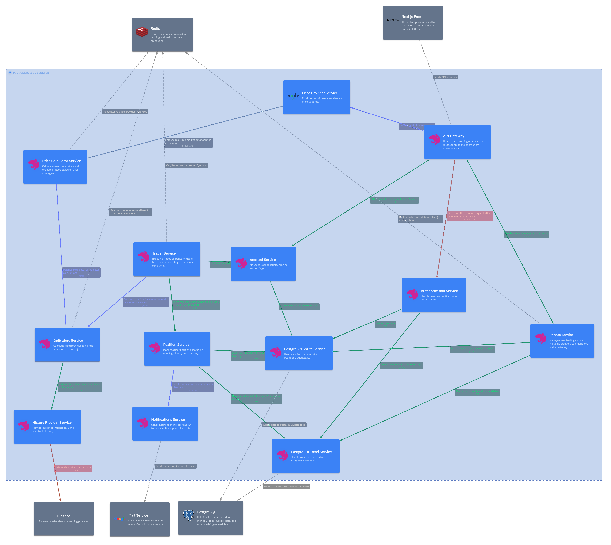

# Algorithmic Trading Platform

A backend for automated cryptocurrency trading. Users register trading robots with indicator-based rules for opening and closing positions. The system reads live prices from Binance, builds candles, computes indicators and places orders when a robot's rules match.

This is a portfolio project: 13 NestJS services and six shared libraries in one repository, with Kafka, Redis, PostgreSQL and MongoDB.

## Architecture

### System context


### Service map



There are two flows.

**Management (HTTP and TCP).** The gateway is the only public HTTP entry point. It proxies `/auth` requests to the auth service over HTTP, checks the JWT cookie on the protected routes, and forwards the request over NestJS TCP to `auth`, `robots`, `accounts` or `pg_read`. Those services reach PostgreSQL only through `pg_read` and `pg_write`.

**Trading pipeline (Redis and Kafka).** `price_provider` holds a WebSocket connection to Binance and publishes prices to Redis pub/sub. `price_calculator` builds OHLC candles and publishes them to the Kafka topic `candle.price`. `indicators` computes RSI and High/Low and publishes to `indicator.trigger`. `trader` evaluates each robot's open and close rules and places orders on Binance. For an account in the test environment it sends no order and only records the position. `positions` records the trade through `pg_write` and publishes to `notification.send`, and `notifications` sends the email.

## Services

- [gateway](apps/gateway/README.md): public HTTP API, JWT check, rate limiting, routing to the internal services
- [auth](apps/auth/README.md): registration, login, refresh and logout, token verification over TCP for the gateway
- [accounts](apps/accounts/README.md): exchange accounts, encrypts and decrypts the API keys
- [robots](apps/robots/README.md): robot creation, indicator rules, the indicator registry in Redis
- [trader](apps/trader/README.md): consumes `indicator.trigger`, evaluates the rules, places orders on Binance
- [positions](apps/positions/README.md): opens and closes positions, publishes notification events
- [price_provider](apps/price_provider/README.md): Binance WebSocket prices to Redis pub/sub
- [price_calculator](apps/price_calculator/README.md): OHLC candles from Redis prices, several instances share the symbols and rebalance through Redis
- [indicators](apps/indicators/README.md): RSI and High/Low from candles
- [history_provider](apps/history_provider/README.md): historical candles from MongoDB, fetched from Binance when missing
- [notifications](apps/notifications/README.md): emails through Gmail, with a Bull queue and retries
- [pg_read](apps/pg_read/README.md) and [pg_write](apps/pg_write/README.md): the only services that talk to PostgreSQL (queries and commands)

## Libraries

| Library | Alias | Contents |
|---|---|---|
| `libs/contracts` | `@app/contracts` | DTOs, types, interfaces, TCP patterns, Kafka topics and event types |
| `libs/core` | `@app/core` | Logger, config schemas, filters, health, metrics, middleware, interceptors, decorators, the internal RPC guard |
| `libs/messaging` | `@app/messaging` | TCP clients, Kafka client module, dead letter queue publisher |
| `libs/redis` | `@app/redis` | Redis client and service, key services, indicators repository, throttler |
| `libs/postgres` | `@app/postgres` | Entities, repositories, migrations, entity-to-contract mappers |
| `libs/mongo` | `@app/mongo` | Mongoose module, abstract repositories, candle storage, log sink |

Dependencies only point down: `contracts` depends on no other lib, `core` may use `contracts`, and the other four may use both. Only `pg_read` and `pg_write` import `@app/postgres`. `@app/contracts/internal` holds the service-to-service contracts and is not part of the `@app/contracts` root export.

## Running locally

Each service reads `apps/<service>/.env`. All services read `env/logger.env`, and `pg_read` and `pg_write` also read `env/postgres.env`. Copy every `.env.example` to a `.env` next to it before the first start (13 in `apps/`, two in `env/`). Config is validated at startup, so a missing variable stops the service.

Everything, including PostgreSQL, Redis, MongoDB, Kafka, Prometheus and Grafana:

```bash
docker compose -f docker-compose.full.yml up --build
```

Only the 13 services, when PostgreSQL, MongoDB, Redis and Kafka already run somewhere else (their hosts come from the `.env` files):

```bash
docker compose up --build
```

One service outside Docker, from the repository root:

```bash
npm install
npx nest start auth --watch
```

### Migrations

The schema is managed with TypeORM migrations, and `POSTGRES_SYNCHRONIZE` is `false` in `env/postgres.env.example` and in `docker-compose.full.yml`. In `docker-compose.full.yml`, `pg_write` runs the pending migrations when it starts. By hand:

```bash
npm run migration:generate -- libs/postgres/src/migrations/DescribeYourChange
npm run migration:show
npm run migration:run
npm run migration:revert
```

A generated migration must also be added to `POSTGRES_MIGRATIONS` in `libs/postgres/src/migrations/index.ts`, or it never runs.

## Endpoints and monitoring

| What | URL |
|---|---|
| HTTP API | http://localhost:4040 |
| Swagger | http://localhost:4040/api/docs |
| Prometheus | http://localhost:9090 |
| Grafana | http://localhost:3001 (`admin` / `admin`) |

Every service serves `/metrics` in Prometheus format, scraped every 15 seconds. `MetricsModule` is in `libs/core` and uses `prom-client`: Node.js runtime metrics with the `trader_microservices_` prefix, and a request duration histogram on `gateway` and `auth`, the two services that listen on HTTP. The other 11 services serve metrics on a separate `METRICS_PORT` (9001 to 9011). The Grafana dashboard in `monitoring/grafana/dashboards/` is provisioned at startup.

## Testing

```bash
npm test                   # unit tests
npm run test:e2e           # jest e2e suites for gateway and auth, no Docker needed
bash scripts/test-e2e.sh   # 41 HTTP and Redis checks against the running full stack
```

The smoke script needs `curl`, `node` and `docker`. It covers registration, login, refresh token rotation, account and robot creation, indicator updates, logout and the paginated lists. It also registers a second user and checks that this user gets 404 when using the first user's account or robot, the same answer as for a robot that does not exist.

## Design decisions

- [ADR 001](docs/adr/0001-split-common-lib.md): one shared library split into six.
- [ADR 004](docs/adr/0004-lock-order.md): lock order for money transactions, and a known gap in order placement.
- Internal contracts are shaped by the consumer: plain interfaces with only the fields that service reads.
- Entities never cross a service boundary. `pg_read` and `pg_write` map them to contract types before answering.
- Requests and responses are built field by field, not with a spread. Each mapper has a leak test that fails if a field outside the contract gets through. Three controller tests in `pg_read` and `pg_write` find the handlers by their `@MessagePattern` metadata, so a new handler is covered without being listed.
- A change on the wire adds the new field first, then switches the consumers, then removes the old field.
- `indicator.trigger` is keyed by symbol, so all triggers for one symbol go to the same partition and the same trader replica. The trader also holds a claim per symbol in Redis and skips a trigger for a symbol another instance has claimed.

## Security

- The password column is not selected by default, and responses are built from a whitelist of fields.
- Login gives the same answer at the same bcrypt cost for an unknown email, an inactive user and a wrong password.
- Another user's robot and a missing robot get the same 404.
- Exchange API keys are stored encrypted with AES-256-GCM.
- Internal TCP calls carry a shared token, compared in constant time.
- Use only Binance testnet keys and a test Gmail account. See [SECURITY.md](SECURITY.md).

## Known gaps

- On a live account the order is placed on Binance before `pg_write` checks the funds (ADR 004).
- Per-service Docker builds, lint boundary rules and CI path filters are not done (ADR 001).
- Old bcrypt hashes are not rehashed on login.
- TCP payloads are not validated. The global `ValidationPipe` does not reach the TCP handlers in any of the 12 services that receive TCP calls, because no service passes `inheritAppConfig` to `connectMicroservice`. The pipe only applies to HTTP requests, at `gateway` and `auth`.
- The correlation id is sent over TCP but the receiver does not pick it up.

## Next

- Outbox, relay and MongoDB read models for the dashboard queries.
- Logs to stdout and Loki.
- Terraform and Kubernetes.
