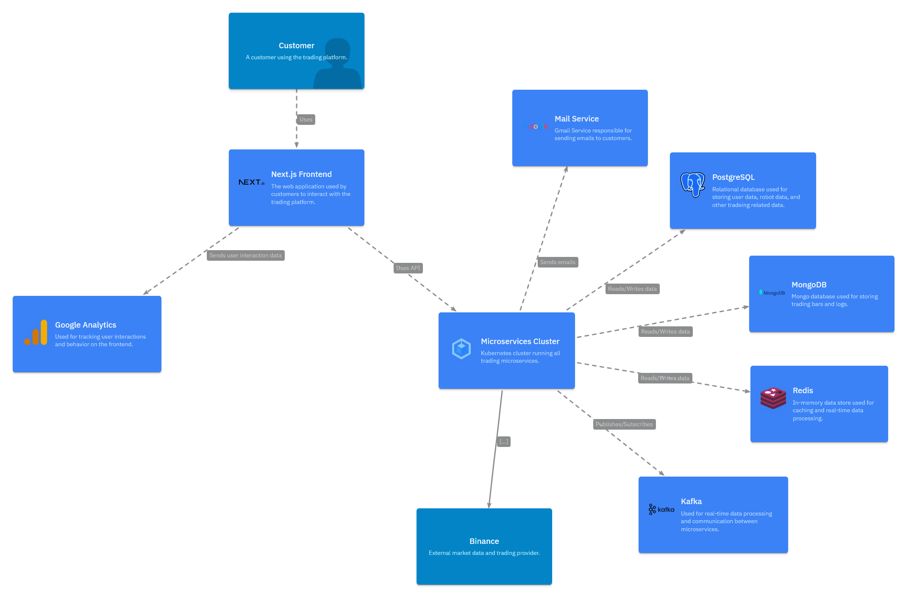

# Algorithmic Trading Platform

A backend system for running automated cryptocurrency trading strategies. Users register trading robots with configurable indicator-based entry and exit rules. The platform ingests live market data, computes technical indicators in real time, and executes orders on Binance when the conditions are met.

This is a portfolio project built to demonstrate a production-style microservices architecture using NestJS, Kafka, Redis, PostgreSQL, and MongoDB. The focus is on event-driven design, service separation, and the kind of problems that come up when you need multiple services to coordinate around a shared real-time data stream.

## Architecture

### System context



The platform sits between a Next.js frontend and a set of external systems: Binance for market data and order execution, Gmail for email notifications, PostgreSQL/MongoDB/Redis for persistence, and Kafka for the internal event pipeline.

### Service map


All services run inside a single Docker network. The API Gateway is the only public entry point. Internal communication uses NestJS TCP microservices (dashed lines) for request/response and Kafka (solid lines) for the event-driven trading pipeline.

## How it works

There are two largely separate flows running at the same time.

The first is the management flow — users interact with the HTTP API (via the gateway) to create accounts, configure robots, and set indicator rules. This goes through a standard request/response chain: gateway authenticates the request and forwards it over TCP to the relevant service, which reads or writes to PostgreSQL through a dedicated read/write service pair.

The second is the trading pipeline, which runs continuously in the background. A price provider holds a persistent WebSocket connection to Binance and pushes raw price updates into Redis. Price calculator instances pick those up, aggregate them into OHLC candles, and publish to Kafka. The indicators service consumes those candles, computes RSI and high/low values for every symbol that has an active robot, and publishes a trigger to Kafka when the indicators are ready. The trader picks up the trigger, evaluates the open and close rules for every robot on that symbol, and executes orders on Binance if any rules fire. After a trade, the positions service records it and emits an event that eventually results in an email to the user.

## Services

Each service has its own README with more detail on what it does and what it's demonstrating.

- [gateway](apps/gateway/README.md) — HTTP entry point, rate limiting, JWT validation, request routing
- [auth](apps/auth/README.md) — Login, JWT issuance, internal token verification
- [accounts](apps/accounts/README.md) — Exchange account management with AES-256-GCM credential encryption
- [robots](apps/robots/README.md) — Robot configuration, indicator assignment, Redis indicator registry
- [trader](apps/trader/README.md) — Order execution engine, Kafka consumer, Binance integration
- [positions](apps/positions/README.md) — Trade record persistence, P&L tracking, event emission
- [price_provider](apps/price_provider/README.md) — Binance WebSocket ingestion, Redis pub/sub fan-out
- [price_calculator](apps/price_calculator/README.md) — OHLC aggregation, horizontally scalable with automatic rebalancing
- [indicators](apps/indicators/README.md) — RSI and High/Low computation, lazy evaluation, Kafka emission
- [history_provider](apps/history_provider/README.md) — Historical candle serving with MongoDB cache and Binance fallback
- [notifications](apps/notifications/README.md) — Email delivery via Gmail OAuth2, Bull queue with retry
- [pg_write](apps/pg_write/README.md) — Centralised PostgreSQL write service (CQRS write side)
- [pg_read](apps/pg_read/README.md) — Centralised PostgreSQL read service (CQRS read side)

## Stack

NestJS 11 (TypeScript) for all services. PostgreSQL with TypeORM for relational data. MongoDB for candles, indicator history, and logs. Redis for pub/sub, rate limiting, Bull queues, and cluster coordination. Apache Kafka in KRaft mode (no Zookeeper) for the event pipeline. Prometheus for metrics collection. Grafana for dashboards and visualisation. Docker Compose for local orchestration.

## Running locally

Infrastructure and all services (including monitoring):

```bash
docker compose -f docker-compose.full.yml up --build
```

Core management services only (gateway, auth, accounts, robots, pg_write, pg_read):

```bash
docker compose up --build
```

For running individual services outside Docker during development:

```bash
npm install
npx nest start auth --watch
```

## Service endpoints

| Service | URL |
|---|---|
| HTTP API + Swagger | http://localhost:4040/api/docs |
| Prometheus | http://localhost:9090 |
| Grafana | http://localhost:3001 |

Grafana default credentials: `admin` / `admin`. The **NestJS Microservices** dashboard is provisioned automatically on first start.

## Monitoring

Every service exposes a `/metrics` endpoint in Prometheus text format, collected every 15 seconds. The shared `MetricsModule` in `libs/common` uses `prom-client` to expose:

- **HTTP request rate** — total requests per service, broken down by method, path, and status code
- **HTTP request duration** — histogram with p50/p95/p99 latency per endpoint
- **Active requests** — in-flight request count
- **Node.js runtime metrics** — heap usage, event loop lag, GC, CPU

All metrics use the `trader_microservices_` prefix. The metric for a TCP microservice (e.g. `pg_write`) is served on a dedicated `METRICS_PORT` (9001–9011) separate from the TCP transport port, since TCP services have no HTTP server.

Prometheus configuration is in `monitoring/prometheus/prometheus.yml`. The Grafana dashboard definition is in `monitoring/grafana/dashboards/` and is provisioned automatically via `monitoring/grafana/provisioning/`.

## Project structure

```
apps/          one directory per microservice
libs/common/   shared modules: TypeORM entities, repositories, Redis, TCP client factory, guards, constants
scripts/       TCP healthcheck utility
```

The `libs/common` library is intentionally the single source of truth for anything shared — entities, event name constants, the JWT guard, and the TCP client registration pattern. If something is needed by more than one service, it lives there.

---

## Notes on specific design decisions

### Kafka partitioning for the trader

The `indicator.trigger` topic is partitioned by symbol (the Kafka message key is the trading pair, e.g. `BTCUSDT`). This means all events for a given symbol always land on the same partition, and therefore always go to the same trader replica in a consumer group. This avoids the need for distributed locking around per-symbol state — the partition assignment is the lock.

Scaling the trader is just a matter of adding replicas to the same consumer group. Kafka rebalances the partitions automatically.

### Database migrations

This project uses TypeORM migrations rather than `synchronize: true`, so schema changes are explicit and reversible.

```bash
# Generate a migration from entity changes
npm run migration:generate -- libs/common/src/database/postgresql/migrations/DescribeYourChange

# Preview pending migrations
npm run migration:show

# Apply
npm run migration:run

# Revert the last migration
npm run migration:revert
```

In production, keep `POSTGRES_SYNCHRONIZE=false` and run migrations as a separate deploy step before starting services.

### E2E smoke tests

With the full stack running:

```bash
bash scripts/test-e2e.sh
```

This runs 38 automated checks covering user registration, JWT auth with refresh token rotation, account and robot CRUD, paginated list endpoints, and post-logout access denial.
